<div align="center">



<p align="center">
  <a href="https://github.com/ishandutta2007/Awesome-Awesome-Awesome"></a><a href="https://discord.gg/jc4xtF58Ve"></a>
  <a href="https://github.com/ishandutta2007/Awesome-Visual-Headless-CMS/stargazers"></a>
  <a href="https://github.com/ishandutta2007/Awesome-Visual-Headless-CMS/network/members"></a>
  <a href="https://github.com/ishandutta2007/Awesome-Visual-Headless-CMS/issues"></a>
  <a href="https://github.com/ishandutta2007/Awesome-Visual-Headless-CMS/blob/main/LICENSE"></a>
  <a href="https://github.com/ishandutta2007/Awesome-Visual-Headless-CMS/pulls"></a>
  <a href="https://github.com/ishandutta2007"></a>
</p>

# 🌟 Awesome Visual Headless CMS

### 🚀 A Curated Directory of Visual Page Builders, API-First CMS & Composable Web Architecture

**Supercharge your modern web stack with the best visual headless content management systems, drag-and-drop page builders, and decoupled editorial platforms.**

</div>

---

## 📖 Introduction & Overview

Welcome to **Awesome Visual Headless CMS** — a deeply researched, community-maintained directory tracking notable **SaaS platforms** and **open-source projects** in the visual and headless CMS ecosystem.

Traditional monolithic CMS platforms couple your database and editorial UI directly to server-rendered presentation templates. In contrast, **Headless Content Management Systems (CMS)** separate content authoring and storage from the frontend presentation layer, delivering structured content via fast GraphQL and REST APIs. **Visual Headless CMS** platforms take this architecture to the next level by equipping editors, content authors, and marketers with real-time preview canvases, drag-and-drop visual component composers, and in-context editing while retaining total code and styling independence for engineering teams.

Whether you are building with **React, Next.js, Vue, Nuxt, Astro, SvelteKit, or mobile apps**, this guide delivers practical insights, pricing comparisons, free tier allowances, and open-source alternatives.

---

## 📑 Table of Contents

- [🌐 Sector Overview & Market Dynamics](#-sector-overview--market-dynamics)
- [🏢 SaaS & Hosted Commercial Platforms](#-saas--hosted-commercial-platforms)
- [💻 Open-Source GitHub Projects](#-open-source-github-projects)
  - [Top Open-Source CMS & Builders (Ranked by Stars)](#-top-open-source-cms--builders-ranked-by-stars)
- [🧭 Architectural Decision Matrix](#-architectural-decision-matrix)
- [🤝 How to Contribute](#-how-to-contribute)
- [📈 Star History](#star-history)
- [💖 Support & Community](#-support--community)
- [📜 Disclaimer & License](#-disclaimer--license)

---

## 🌐 Sector Overview & Market Dynamics

- 📊 **Market Size & High Growth**: The global Headless Content Management System and Composable DXP market is valued at approximately **$950M to $1.2B in 2025–2026** and is projected to expand past **$3.8B to $4.5B by 2032**, achieving a rapid compound annual growth rate (**CAGR of ~21.8%**). Growth is powered by widespread enterprise adoption of Jamstack/MACH (Microservices, API-first, Cloud-native, Headless) architectures, multi-channel omnichannel publishing (web, mobile, IoT, digital signage), and the surging demand for visual page composition tools that empower non-technical marketing teams without breaking frontend design systems.
- 🧩 **Market Fragmentation vs. Consolidation**: The sector displays **moderate to high fragmentation** rather than an absolute "winner-take-all" monopoly. While tier-1 enterprise stalwarts (such as Contentful and Sanity) lead high-budget corporate digital transformations, focused visual page composition engines (like Storyblok and Builder.io) and powerhouse open-source ecosystems (such as Strapi, Payload, and Directus) hold defensible market segments. Because development teams vary wildly in their architectural philosophies—ranging from Git-based flat-file workflows and code-first TypeScript schemas to database-first backends and drag-and-drop landing page builders—the ecosystem thrives with resilient multi-vendor coexistence.

---

## 🏢 SaaS & Hosted Commercial Platforms

Below is a detailed comparison of leading commercial SaaS platforms and managed headless cloud solutions. The table is **sorted descending by estimated company size** (market valuation / annual recurring revenue).

| 🏢 Platform | 💰 Company Scale (Valuation / ARR) | 🏷️ Starting Tier Price | 🎁 Free Tier / Trial Limit | 🎯 Key Visual & Headless Highlights |
| :--- | :--- | :--- | :--- | :--- |
| **[Webflow](https://webflow.com/)** | **~$4.0B Valuation** (~$160M+ ARR) | **$14/month** (Basic) or **$23/month** (CMS billed annually) | **$0 Free Plan**: 2 static pages, 50 CMS items, 1GB bandwidth, 50 form submissions, staging on `.webflow.io` domain | 🎨 Visual canvas pioneer with integrated headless CMS, designer-friendly CSS controls, client billing, and REST API publishing. |
| **[Contentful](https://www.contentful.com/)** | **~$3.0B Peak Valuation** (~$200M+ ARR) | **$300/month** (Basic plan, billed monthly) | **$0 Free Forever Plan**: 1 space, 5 users, 25 content types, 100K API calls/month, 50GB CDN bandwidth | 🏛️ Enterprise-standard composable content platform with App Framework, localized content modeling, and Contentful Studio visual canvas. |
| **[Storyblok](https://www.storyblok.com/)** | **~$350M–$500M Valuation** (~$80M ARR) | **$99/month** (Growth plan; $90.75/mo billed annually) | **$0 Free Starter Plan**: 1 space, 1 user seat, 20,000 stories, 100K API requests/month, 100GB traffic/month, 2 locales | 🖼️ Real-time visual editor with interactive live preview iframe, nestable component blocks, and responsive omnichannel rendering. |
| **[Builder.io](https://www.builder.io/)** | **~$195M Valuation** (~$15M–$20M ARR) | **$24/user/month** (Pro plan) or **$40/user/month** (Team plan) | **$0 Free Plan**: 1 space, up to 5 user seats, 75 monthly AI Agent credits (25 daily cap), 1 Design System, Figma sync | ⚡ Drag-and-drop visual page builder that connects directly to production React, Next.js, Vue, and Svelte component libraries. |
| **[Sanity.io](https://www.sanity.io/)** | **~$170M+ Valuation** (~$40M+ ARR) | **$15/seat/month** (Growth plan) | **$0 Free Forever Plan**: 20 user seats, 2 datasets, 10,000 documents/dataset, 1M CDN API requests/mo, 250K live API calls/mo, 100GB assets | 🧠 Unified Content Lake with customizable open-source React Sanity Studio, GROQ / GraphQL query engines, and live multiplayer collaboration. |
| **[Strapi Cloud](https://strapi.io/cloud)** | **~$100M+ Valuation** (~$10M+ ARR) | **$29/project/month** (Developer plan billed annually; $35/mo monthly) | **14-day Free Trial**: Full Developer plan access (100K API requests, 15GB bandwidth, 15GB storage, 1 environment; self-hosted open-source is 100% free) | 🚀 Fully managed cloud hosting for Strapi with visual Content-Type Builder, automatic database provisioning, and CDN caching. |
| **[Prismic](https://prismic.io/)** | **~$75M–$100M Valuation** (~$18M ARR) | **$15/repository/month** (Starter plan; $39/mo for Small Team) | **$0 Free Forever Plan**: 1 user, 1 repository, 2 locales, unlimited documents, 100GB CDN bandwidth/month | 🧩 Slice Machine component-driven visual builder integrating seamlessly with Next.js, Nuxt, and Svelte component architecture. |
| **[Kontent.ai](https://kontent.ai/)** | **~$75M+ Valuation** (~$20M ARR, $40M Series A) | **$999/month** (Modular Flex Starter package) | **30-day Free Trial**: Full-featured enterprise evaluation sandbox with modular workflow stages and multi-channel API delivery | 🏢 Enterprise-grade headless CMS with visual Spotlight live editing, granular editorial governance, and AI skill assist. |
| **[Hygraph](https://hygraph.com/)** | **~$40M–$60M Valuation** (~$8M ARR) | **$199/month** (Growth plan) | **$0 Free Forever ("Hobby") Plan**: 3 seats, 1,000 content entries, 10 components, 2 locales, 500,000 API calls/month, 100GB asset traffic | 🕸️ Federated GraphQL-native headless CMS unifying remote data sources, schema stitching, and granular programmatic content APIs. |
| **[DatoCMS](https://www.datocms.com/)** | **~$35M–$50M Valuation** (~$6M+ ARR) | **$149/month** (Professional plan; $99/mo billed annually) | **$0 Free Forever Plan**: 1 collaborator, 300 records, 100K API requests/month, 10GB bandwidth/month, 10 video streaming minutes | ⚡ High-performance Jamstack CMS with real-time editing updates, modular content blocks, image/video optimization, and GraphQL. |
| **[ButterCMS](https://buttercms.com/)** | **~$20M–$30M Valuation** (~$4M ARR) | **$99/month** (Micro plan; $83/mo billed annually) | **30-day Free Trial**: 1 site/blog, 10 content collections, 5,000 API calls/month, and 2 collaborator seats | 🥞 Plug-and-play headless CMS and blogging engine with quick SDK integrations for Ruby, Python, Node.js, PHP, and React. |
| **[Ghost(Pro)](https://ghost.org/pricing/)** | **~$15M–$25M Equivalent** (Non-Profit Foundation, $10M+ ARR) | **$15/month** (Starter tier billed annually; $18/mo monthly) | **14-day Free Trial**: Up to 1,000 members, custom domain, newsletter broadcasts, and Koenig rich card editor (no credit card required) | ✍️ Premium publishing platform with memberships, paid subscriptions, and a headless Content API for JAMstack websites. |
| **[Agility CMS](https://agilitycms.com/)** | **~$15M–$20M Valuation** (~$4M ARR) | **$1,249/month** (Starter/Pro Cloud package) | **14-day Free Trial**: Proof-of-concept sandbox with visual page management, multi-channel content trees, and guided support | 🌲 Hybrid CMS combining structured content modeling with traditional sitemap page trees and visual component placement. |

---

## 💻 Open-Source GitHub Projects

Open-source headless CMS platforms provide total data sovereignty, self-hosted deployment flexibility, and elimination of vendor lock-in.

### 🏆 Top Open-Source CMS & Builders (Ranked by Stars)

The following repositories are **sorted strictly descending by GitHub star count**. Each badge displays the live social star count and links directly to the repository's stargazers.

1. **[Strapi](https://github.com/strapi/strapi)** [](https://github.com/strapi/strapi/stargazers)  
   *The leading open-source headless CMS built with 100% JavaScript & TypeScript.*  
   Features an intuitive visual Content-Type Builder, automatic REST and GraphQL API generation, dynamic media library with responsive formats, granular RBAC (Role-Based Access Control), and an expansive plugin marketplace.

2. **[Ghost](https://github.com/TryGhost/Ghost)** [](https://github.com/TryGhost/Ghost/stargazers)  
   *Independent, modern open-source publishing, newsletter, and subscription engine.*  
   Equipped with the extensible Koenig rich-text card editor, integrated member signups and Stripe billing, native SEO tags, and a decoupled headless Content API for modern Jamstack frontends.

3. **[Payload CMS](https://github.com/payloadcms/payload)** [](https://github.com/payloadcms/payload/stargazers)  
   *The open-source, full-stack Next.js and TypeScript-first headless CMS.*  
   Provides schema configuration purely in code, auto-generated TypeScript interfaces, instant GraphQL/REST endpoints, SQLite/PostgreSQL/MongoDB database adaptors, and a custom React-based administrative UI.

4. **[Directus](https://github.com/directus/directus)** [](https://github.com/directus/directus/stargazers)  
   *Instant headless data platform and REST/GraphQL API engine over any SQL database.*  
   Wraps existing PostgreSQL, MySQL, SQLite, Oracle, or SQL Server databases with a polished no-code collaborative studio, real-time WebSockets, granular row-level security, and custom data visualizations.

5. **[GrapesJS](https://github.com/GrapesJS/grapesjs)** [](https://github.com/GrapesJS/grapesjs/stargazers)  
   *Free, open-source multi-purpose Web Builder Framework and visual template editor.*  
   Enables developers to embed visual HTML/CSS drag-and-drop page builders, responsive device switches, component block systems, and visual styling toolbars into any existing headless CMS.

6. **[Decap CMS](https://github.com/decaporg/decap-cms)** [](https://github.com/decaporg/decap-cms/stargazers)  
   *Git-based headless CMS for static site generators (formerly Netlify CMS).*  
   Operates as a client-side React single-page app that interfaces directly with your GitHub, GitLab, or Bitbucket repository. Content edits are committed as standard Git pull requests and commits in Markdown, JSON, or YAML.

7. **[Grav](https://github.com/getgrav/grav)** [](https://github.com/getgrav/grav/stargazers)  
   *Modern, crazy-fast, open-source flat-file CMS powered by PHP, Twig, and Markdown.*  
   Requires zero SQL databases—content files are organized in clean filesystem folder hierarchies. Offers headless JSON endpoints, caching, visual admin plugin interfaces, and responsive image handling.

8. **[TinaCMS](https://github.com/tinacms/tinacms)** [](https://github.com/tinacms/tinacms/stargazers)  
   *Open-source headless CMS with real-time in-context visual editing for Git repositories.*  
   Bridges Markdown/MDX files and Git version control with a live sidebar/on-page editing canvas for Next.js, Astro, Remix, and Hugo. Content changes trigger automated Git commits.

9. **[Puck](https://github.com/puckeditor/puck)** [](https://github.com/puckeditor/puck/stargazers)  
   *The visual editor and component composer for React and Next.js.*  
   Enables software teams to declare standard React components that non-technical editors can drag, drop, configure, and reorder visually within a headless architecture.

10. **[KeystoneJS](https://github.com/keystonejs/keystone)** [](https://github.com/keystonejs/keystone/stargazers)  
    *The superpowered headless CMS and GraphQL platform for Node.js.*  
    Features a declarative TypeScript schema configuration that automatically generates a strict GraphQL API and an admin interface built on React, Next.js, and Prisma ORM.

11. **[React Page](https://github.com/react-page/react-page)** [](https://github.com/react-page/react-page/stargazers)  
    *Next-gen, highly customizable visual content editor and layout builder for the browser.*  
    Built with React and TypeScript, delivering WYSIWYG capabilities with modular plugins, slate rich text, nested responsive layouts, and JSON output for headless ingestion.

12. **[Builder.io Core SDKs](https://github.com/BuilderIO/builder)** [](https://github.com/BuilderIO/builder/stargazers)  
    *Visual development and drag-and-drop headless SDKs for modern frontend frameworks.*  
    Open-source component connection libraries for React, Vue, Svelte, Qwik, and Angular that render dynamic visual content blocks directly inside modern application shells.

13. **[Webiny](https://github.com/webiny/webiny-js)** [](https://github.com/webiny/webiny-js/stargazers)  
    *Serverless enterprise CMS platform architected on AWS Lambda, DynamoDB, and S3.*  
    Provides multi-tenancy, a visual Page Builder, Form Builder, Headless CMS with GraphQL API, lifecycle hooks, and an AI-assisted MCP server for large organizational deployments.

14. **[Sanity Studio Core](https://github.com/sanity-io/sanity)** [](https://github.com/sanity-io/sanity/stargazers)  
    *The open-source, customizable React content workspace for Sanity.io.*  
    Enables engineering teams to tailor form inputs, configure live preview panes, build custom studio dashboard widgets, and define content models entirely in TypeScript.

15. **[Cockpit CMS](https://github.com/agentejo/cockpit)** [](https://github.com/agentejo/cockpit/stargazers)  
    *Lightweight plug-and-play headless content platform and API-first manager.*  
    Zero configuration overhead, clean administrative dashboard, custom content collections, multi-language support, and lightweight storage options (SQLite or MongoDB).

16. **[ApostropheCMS](https://github.com/apostrophecms/apostrophe)** [](https://github.com/apostrophecms/apostrophe/stargazers)  
    *Full-featured content management framework combining in-context editing and headless APIs.*  
    Built with Node.js, Express, and Vue 3. Supports contextual on-page visual editing, modular widget areas, draft/publish workflows, and decoupled REST/GraphQL endpoints.

17. **[Outstatic](https://github.com/avitorio/outstatic)** [](https://github.com/avitorio/outstatic/stargazers)  
    *Static site CMS and dashboard for Next.js with Markdown and MDX support.*  
    Stores all content files directly inside your GitHub repository without external database dependencies, delivering a clean visual dashboard, custom fields, and Git commits.

18. **[Squidex](https://github.com/Squidex/squidex)** [](https://github.com/Squidex/squidex/stargazers)  
    *Headless CMS and content management hub built on .NET Core with CQRS & Event Sourcing.*  
    Offers full audit history for every content mutation, GraphQL and REST APIs, rule-based webhooks, digital asset management, and high-performance containerized Docker deployments.

19. **[CrafterCMS](https://github.com/craftersoftware/craftercms)** [](https://github.com/craftersoftware/craftercms/stargazers)  
    *Git-native headless CMS engineered for enterprise composable digital experiences.*  
    Combines Git-backed versioning, in-context multi-channel previews, decoupled headless microservices, and high-security architectures separating authoring and delivery tiers.

---

## 🧭 Architectural Decision Matrix

To select the right visual headless CMS for your project, align your technical requirements with these primary archetypes:

```
┌────────────────────────────────────────────────────────────────────────┐
│                        WHICH CMS SHOULD YOU CHOOSE?                    │
└────────────────────────────────────────────────────────────────────────┘
                                    │
           ┌────────────────────────┴────────────────────────┐
           ▼                                                 ▼
   [ Visual-First Focus ]                           [ Code/API-First Focus ]
   • Marketers need drag & drop                     • Developers control schema & UI
   • In-context preview is essential                • Deep framework integration
           │                                                 │
   ┌───────┴───────┐                                 ┌───────┴───────┐
   ▼               ▼                                 ▼               ▼
[ SaaS Hosted ]  [ Open-Source / Self-Hosted ]    [ Cloud Native ]  [ Git-Backed ]
• Storyblok      • GrapesJS                       • Sanity.io       • TinaCMS
• Builder.io     • Puck                           • Contentful      • Decap CMS
• Webflow        • ApostropheCMS                  • Strapi / Directus• Outstatic
```

| Criteria | 🎨 Visual Page Builders | ⚡ Structured Headless CMS | 📦 Git-Backed CMS |
| :--- | :--- | :--- | :--- |
| **Primary Beneficiary** | Marketing & Content Authors | Engineers & Enterprise Architects | Developers & Technical Writers |
| **Data Storage** | Proprietary Cloud or Component JSON | Relational SQL, NoSQL, or Cloud Lake | Git Repository (Markdown, YAML, MDX) |
| **Visual Editing** | Full WYSIWYG Drag-and-Drop | Form fields with Preview iframe | Sidebar or Split-Screen in-context |
| **Best For** | Landing pages, e-commerce stores, microsites | Mobile apps, omnichannel hubs, SaaS web portals | Blogs, documentation portals, portfolio sites |
| **Top Recommendations** | Builder.io, Storyblok, Puck | Payload, Strapi, Sanity, Directus | TinaCMS, Decap CMS, Outstatic |

---

## 🤝 How to Contribute

Contributions from the developer and CMS community are warmly welcomed! To suggest a new tool, correct existing pricing data, or expand documentation:

1. **Fork the Repository** on GitHub: `https://github.com/ishandutta2007/Awesome-Visual-Headless-CMS`.
2. **Create a Feature Branch**: `git checkout -b feature/add-new-cms`.
3. **Add or Update Entries**: Follow the exact markdown format, include factual pricing tiers, free tier specifications, and valid links.
4. **Sort Appropriately**:
   - For SaaS additions: Sort by company size / revenue descending.
   - For Open-Source additions: Include the white social star badge and sort by stars descending.
5. **Submit a Pull Request** with a concise description of your changes.

Check out [Awesome-Awesome-Awesome](https://github.com/ishandutta2007/Awesome-Awesome-Awesome) for more curated lists!

---

##  Star History

[](https://star-history.dera.page/#ishandutta2007/Awesome-Visual-Headless-CMS&type=date&legend=top-left)

---

## 💖 Support & Community

Thank you for visiting and using **Awesome Visual Headless CMS**! If this curated guide saves you time or empowers your team's architectural decisions, please consider supporting the project:

- ⭐ **Star this repository** to improve visibility across the open-source ecosystem.
- 🍴 **Fork and share** with fellow developers on [Discord](https://discord.gg/jc4xtF58Ve), X (Twitter), and LinkedIn.
- ☕ **Buy a coffee & sponsor**: If you'd like to back ongoing research and maintenance, please visit the [GitHub Sponsor Dashboard](https://github.com/sponsors/ishandutta2007).

---

## 📜 Disclaimer & License

- **Community Curated**: This repository is an independent, community-driven resource. All product names, logos, and trademarks belong to their respective owners. Mentioning a tool does not constitute a commercial endorsement.
- **Data Accuracy**: Pricing tiers, free quotas, and venture metrics change over time. Please verify current limits with each provider prior to deploying mission-critical production infrastructure.
- **License**: Released under the [MIT License](LICENSE).
